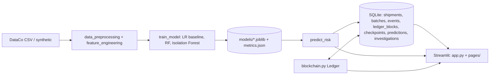

# TrustChain AI
**ML-powered supply-chain risk detection and tamper-evident product traceability** — Python · scikit-learn · Streamlit · SQLite · SHA-256 hash-linked ledger.

| Capability | Implementation |
|---|---|
| Late-delivery risk | Random Forest, compared with a Logistic Regression baseline (precision, recall, F1, ROC-AUC, confusion matrix) |
| Unusual-shipment detection | Isolation Forest on numeric features (an *anomaly*, never "confirmed fraud") |
| Traceability | Product batches + MANUFACTURED/DISPATCHED/RECEIVED/INSPECTED/DELIVERED events, QR lookup |
| Integrity | Local SHA-256 hash-linked ledger, checkpoints, tamper tests |
| UI | 5-page dark Streamlit dashboard with Plotly |

## Honest limitations (read this before an interview)
* The ledger is a **local hash-linked ledger, not a decentralised blockchain**: one operator controls it and there is no consensus. It shows data was not altered *after* writing; it does **not** prove the data was true.
* Deleting the newest blocks is detectable only with a **trusted checkpoint** (saved in the DB and exportable). Rewriting the whole chain consistently is also caught only by an external checkpoint.
* Without the real DataCo file, the app generates **SYNTHETIC** data (clearly labelled in the UI). Scores on it (~0.65 ROC-AUC) only demonstrate the pipeline. No accuracy numbers are hard-coded; everything shown comes from `models/metrics.json` produced by training.
* The anomaly demo uses **simulated** injected outliers, labelled as such. No real fraud labels are used or implied.
* No-leakage rule: features are only `shipping_mode, scheduled_days, region, market, category, quantity, unit_price, discount_rate, customer_segment` + order month/weekday/value. `late_delivery`, `actual_days`, delivery status and shipping date are excluded and ignored in uploads.
* Single-user design (SQLite); the optional Solidity contract is provided but not part of the tested core.

## Quick start
```bash
python -m venv .venv
source .venv/bin/activate          # Windows: .venv\Scripts\activate
pip install -r requirements.txt

python -m src.bootstrap            # init DB, load data, train models, seed demo batches + ledger (~1 min)
streamlit run app.py               # opens http://localhost:8501
```
You can skip `bootstrap`: on first launch the dashboard shows a **Generate demo data and train models** button that does the same thing.

## Using the real DataCo dataset
1. Download *DataCo Smart Supply Chain for Big Data Analysis* from Kaggle (or Mendeley Data).
2. Save it as `data/DataCoSupplyChainDataset.csv` (it is read with `latin-1` encoding automatically).
3. `python -m src.bootstrap --data data/DataCoSupplyChainDataset.csv --max-rows 20000`

Column mapping lives in `src/data_preprocessing.py` (`DATACO_MAP`).

## Individual commands
| Task | Command |
|---|---|
| Train models only | `python -m src.train_model [--data file.csv]` |
| Reset DB + reseed | `python -m src.bootstrap` |
| Run tests (32) | `pytest` |
| Run app | `streamlit run app.py` |

## Pages
1. **Executive Dashboard** (`app.py`) – KPIs, late rate by mode/region/month, risk distribution, risk heatmap, searchable table.
2. **ML Risk Prediction** – form + CSV upload, probability gauge, risk class, anomaly flag, top factors, CSV download.
3. **Product Traceability** – search batch, journey timeline, QR code, create batches, record events.
4. **Blockchain Verification** – ledger table, VALID/INVALID status, checkpoints, tamper demo on an in-memory copy.
5. **Investigation Center** – high-risk queue, unusual patterns, investigation records (status, priority, notes, outcome).

## Architecture


## Project layout
```
app.py                       Page 1 – Executive Dashboard
pages/                       Pages 2–5
src/config.py                paths, feature lists, constants
src/data_preprocessing.py    load / clean / validate (uploads too)
src/feature_engineering.py   derived features + sklearn preprocessor
src/train_model.py           LR baseline, RF, IF, metrics, joblib
src/predict_risk.py          scoring + factor explanation
src/anomaly_detection.py     Isolation Forest + simulated-anomaly check
src/blockchain.py            ledger, verification, tamper demo
src/database.py              schema (PK/FK/CHECK) + parameterised queries
src/bootstrap.py             one-shot setup
src/utils.py                 theme, badges, QR, setup guard
tests/                       ledger, DB, ML, page smoke tests
blockchain_contracts/        optional Solidity anchor contract
```

## Database tables
`shipments`, `product_batches`, `supply_chain_events`, `ledger_blocks`, `ledger_checkpoints`, `prediction_history`, `investigations` – foreign keys enforced (`PRAGMA foreign_keys=ON`), CHECK constraints on event types, ranges and statuses. Only business fields are stored; no personal data.

## Ledger design
`hash = SHA256(f"{block_id}|{prev_hash}|{canonical_json(payload)}")`, with canonical JSON = sorted keys, no whitespace. `verify()` detects: altered block data, broken links, missing middle blocks, events edited after hashing, events without a block, truncated chain / checkpoint mismatch.

## Common errors
| Symptom | Fix |
|---|---|
| `ModuleNotFoundError: src` | Run commands from the project root (the folder containing `app.py`). |
| Dashboard shows the setup screen | Run `python -m src.bootstrap` or click the button. |
| `Not a DataCo file - missing columns` | Use the original DataCo CSV; don't edit headers. |
| Models fail to load after upgrading scikit-learn | Re-run `python -m src.train_model` (joblib files are version-specific). |
| Port busy | `streamlit run app.py --server.port 8502` |
| `database is locked` | Close other processes using `data/trustchain.db`. |

## Screenshots
Run the app, open each page, and save PNGs into `docs/` (Windows: `Win+Shift+S`, macOS: `Cmd+Shift+4`). Suggested names: `01_dashboard.png`, `02_prediction.png`, `03_traceability.png`, `04_ledger_tamper.png`, `05_investigation.png`; then embed them here with ``.

## Publish to GitHub
```bash
git init && git add . && git commit -m "TrustChain AI"
git branch -M main
git remote add origin https://github.com/<you>/TrustChainAI.git
git push -u origin main
```
`.gitignore` excludes the DB, models and CSVs; they are regenerated by the setup button.

## Deploy on Streamlit Community Cloud
1. Push to GitHub. 2. share.streamlit.io → *New app* → repo, branch `main`, main file `app.py`.
3. Open the app and click **Generate demo data and train models** (cloud storage is ephemeral, so data resets on restart).
4. Set `TRUSTCHAIN_BASE_URL` in *Secrets/Environment* so QR codes point to your public URL. Never commit secrets.

## Optional extension
`blockchain_contracts/TrustChainAnchor.sol` anchors the latest ledger hash on a local Ethereum dev network (see its README).
